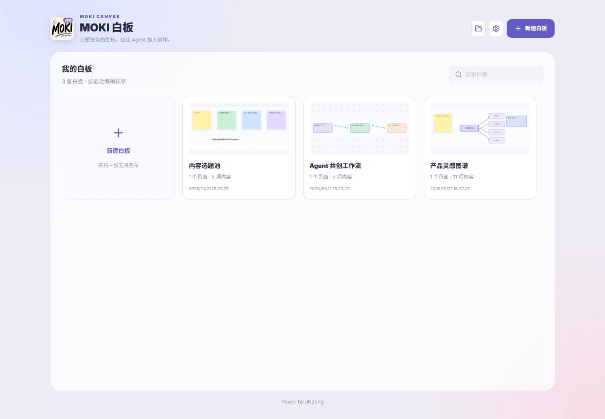
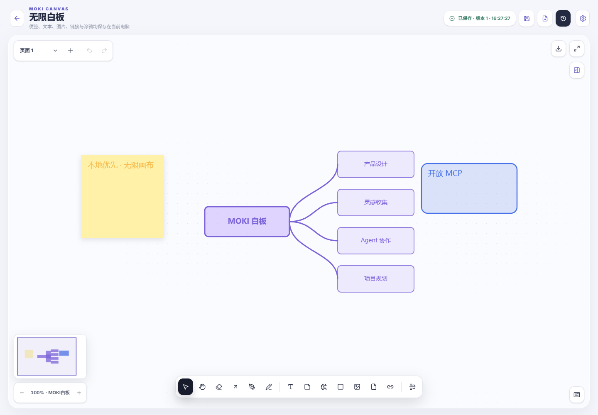
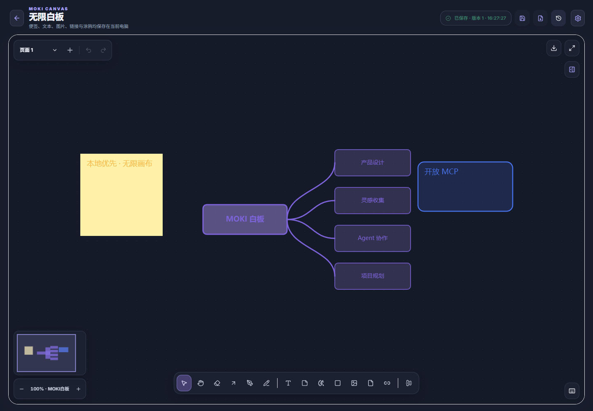
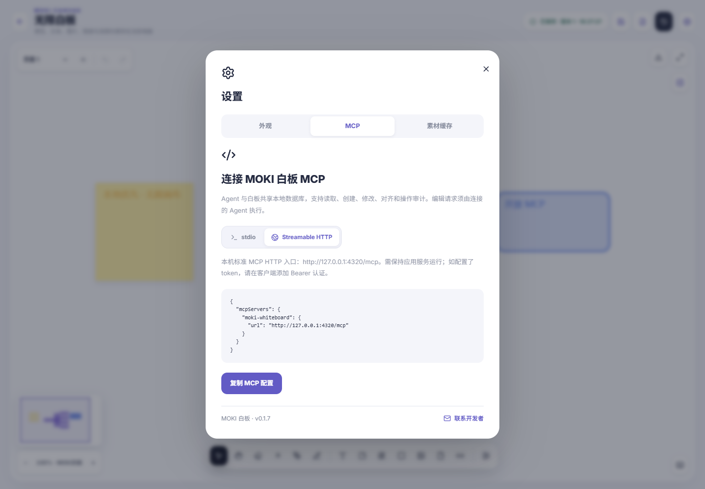

# MOKI 白板 · MOKI Whiteboard

本地优先、支持 MCP Agent 操作的开源无限画布。

A local-first, open-source infinite canvas that MCP-enabled agents can read and edit.

[简体中文](#zh-cn) · [English](#english)

[](https://github.com/JKZeng-cell/moki-whiteboard/actions/workflows/ci.yml)
[](LICENSE)
[](package.json)

<a id="zh-cn"></a>

MOKI 白板从 MOKI 工作台的无限白板能力演化而来，提供独立的 React / Electron 应用、本地 SQLite 存储和标准 MCP Server。你可以自己编辑画布，也可以让支持 MCP 的 Agent 读取、创建、修改、对齐和导出白板内容。



## 为什么做这个项目

- **本地优先**：白板数据库和素材默认保存在自己的电脑中。
- **Agent 真正可操作**：不是旁边放一个聊天框，而是通过 MCP 直接读写画布对象。
- **完整无限画布**：便签、文本、图形、钢笔、思维导图、图片、文件和网页卡片在同一套交互中工作。
- **文件可迁移**：通过 `.moki` 文件在独立白板与 MOKI 工作台之间双向迁移页面和素材。

| 浅色画布 | 深色画布 |
| --- | --- |
|  |  |

## 图文介绍

[查看七张发布介绍图与中英双语预览页](docs/showcase/README.md)，了解多媒体置入、思维导图、分页管理、素材管理与 MCP Agent 协作。

## 主要能力

- 白板管理：新建、搜索、重命名、复制、删除，以及上次编辑内容缩略图；进入编辑页后显示当前白板名称。
- 无限画布：连续无级缩放、平移、适应内容、缩略图导航与全屏。
- 内容工具：便签、文本、六类图形、四种箭头、四档画笔、贝塞尔钢笔路径、9 类思维导图模板、图片 / GIF / 视频、文件和链接。
- 编辑交互：多选、旋转、角点缩放、边缘拉伸、编组 / 资料夹、对齐 / 分布、剪贴板、撤销 / 重做和就地文本编辑。
- 分组整理：将相关内容编组，收起为画布中的虚拟文件夹（资料夹）；需要时再展开，分组管理整洁有序。
- 页面系统：多页面、页面分组、跨页面内容检索与定位、页面历史版本和恢复。
- 本地资料：文件 / 文件夹插入、素材列表、预览与重命名，可自定义素材缓存路径。
- 外观：浅色、深色和跟随系统。
- 文件互通：支持 v2 `.moki` ZIP，并兼容旧 `.moki-board`、封装 JSON 和原始快照。
- 安全写入：SQLite WAL、乐观版本冲突保护、操作审计和异常剪贴板原子校验。

## MCP 与 Agent

MOKI 白板提供标准 stdio 和 Streamable HTTP 两种 MCP 连接方式，共 16 个工具，并提供 Resource 与 Prompt。



代表性工具：

| 工具 | 能力 |
| --- | --- |
| `whiteboard_list` | 列出白板 |
| `whiteboard_inspect` | 读取页面、元素、文本、位置和 ID |
| `whiteboard_add_elements` | 添加便签、文本、图形、箭头、笔迹、思维导图、图片、文件和链接 |
| `whiteboard_update_elements` | 修改内容、位置、尺寸、颜色、样式和旋转 |
| `whiteboard_align_elements` | 对齐或等距分布元素 |
| `whiteboard_manage_pages` | 查询、重命名、分组或删除页面 |
| `whiteboard_export` | 导出完整 `.moki` 白板 |
| `whiteboard_native_edit` | 原生属性、编组、资料夹和思维导图层级操作 |

推荐 Agent 流程：

1. `whiteboard_list`
2. `whiteboard_inspect`
3. 使用返回的准确 ID 和 `expectedVersion` 修改
4. 再次 inspect 验证结果

版本冲突会返回 `VERSION_CONFLICT`，不会静默覆盖较新的白板内容。HTTP MCP 默认仅用于本机；不要直接暴露到公网。需要本机认证时可设置 `MOKI_WHITEBOARD_MCP_TOKEN`。

## 快速开始

需要 Node.js 22.5 或更高版本，推荐当前 LTS。

```powershell
git clone https://github.com/JKZeng-cell/moki-whiteboard.git
cd moki-whiteboard
npm ci
npm run dev
```

浏览器界面默认位于 `http://127.0.0.1:4320`，API 位于 `http://127.0.0.1:4321`，开发数据库位于 `data/moki-whiteboard.db`。

运行桌面客户端：

```powershell
npm run desktop
```

验证全部类型、测试和生产构建：

```powershell
npm run check
npm run test:mcp:stdio
```

## MCP 配置

先运行 `npm run build`，再将绝对路径替换成你的克隆目录：

```json
{
  "mcpServers": {
    "moki-whiteboard": {
      "command": "node",
      "args": ["D:/path/to/moki-whiteboard/dist/mcp/server.js"],
      "env": {
        "MOKI_WHITEBOARD_DATA": "D:/path/to/moki-whiteboard/data/moki-whiteboard.db"
      }
    }
  }
}
```

也可以在应用设置中切换到 Streamable HTTP，并复制当前本机地址。不同 Agent 客户端的配置文件结构可能不同，MCP 规范不统一规定客户端配置文件键名。

## Windows 打包

Windows 上执行：

```powershell
npm run desktop:dist
```

脚本会创建新的 `release-build-*` 目录并生成 x64 NSIS 安装包与完整免安装 ZIP，不覆盖已有产物。桌面数据默认保存在 `%APPDATA%/moki-whiteboard`，卸载不会主动删除用户数据库。

当前项目的 Windows 安装包尚未进行代码签名，可能出现未知发布者或 SmartScreen 提示。请只从项目 Release 或明确的官方渠道下载，并核对 SHA-256。

## 项目结构

```text
src/core/         白板快照、页面与元素模型
src/server/       SQLite 存储和本地 HTTP API
src/mcp/          标准 MCP Server
src/web/          React 管理页与应用入口
src/desktop/      Electron 桌面外壳
src/vendor/moki/  无限白板、思维导图、文件归档和预览组件
tests/            核心、API 和 MCP 协议测试
docs/             截图与发布资料
```

## 数据与隐私

- 项目不会把 `data/`、素材缓存、安装包或构建产物提交到 Git。
- `.moki`、SQLite 数据库和素材缓存可能包含用户内容，公开分享前请自行检查。
- 浏览器不能直接调用部分系统能力；文件夹选择、默认应用和本机文件打开由 Electron 桥接完成。
- 应用不内置模型账号。Agent 能力来自你自行连接的 MCP 客户端。

## 参与贡献

欢迎 Issue 和 Pull Request。请先阅读 [CONTRIBUTING.md](CONTRIBUTING.md)；安全问题请按照 [SECURITY.md](SECURITY.md) 私下报告。

## License

[MIT](LICENSE) © 2026 JKZeng

---

## English

[Back to 简体中文](#zh-cn)

MOKI Whiteboard is a standalone React / Electron application evolved from the infinite whiteboard in MOKI Workbench. It combines a local SQLite database with a standard MCP server. Edit the canvas yourself, or let an MCP-enabled agent inspect, create, update, align, and export its contents.


### Why MOKI Whiteboard?

- **Local-first:** board databases and assets are stored on your computer by default.
- **Agents can actually edit:** MCP provides direct access to canvas objects, rather than just a chat panel beside the board.
- **One infinite canvas:** combine sticky notes, text, shapes, pen paths, mind maps, images, files, and web cards.
- **Portable boards:** move pages and assets between MOKI Whiteboard and MOKI Workbench using `.moki` files.

| Light canvas | Dark canvas |
| --- | --- |
|  |  |

### Visual Showcase

[Explore all seven launch images and the bilingual preview page](docs/showcase/README.md): multimedia, mind maps, pages, asset management, and MCP agent collaboration.

### Features

- Board management: create, search, rename, duplicate, delete, and view thumbnails from the last editing session. The editor header shows the current board name.
- Infinite canvas: continuous zoom, pan, fit to content, minimap navigation, and fullscreen.
- Creation tools: sticky notes, text, six shape types, four arrow styles, four brush sizes, Bézier pen paths, nine mind-map templates, images / GIFs / videos, files, and links.
- Editing: multi-select, rotation, corner scaling, edge resizing, groups / folders, alignment / distribution, clipboard, undo / redo, and inline text editing.
- Group organization: group related content and collapse it into a virtual folder on the canvas. Expand it when needed to keep your workspace tidy and organized.
- Pages: multiple pages, page groups, cross-page content search and navigation, and per-page version history and restoration.
- Local assets: insert files / folders, locate and preview assets, rename them, and configure the asset-cache directory.
- Appearance: light, dark, or follow the system theme.
- Interoperability: v2 `.moki` ZIP archives, legacy `.moki-board` files, wrapped JSON, and raw snapshots.
- Safer writes: SQLite WAL, optimistic version-conflict protection, operation auditing, and atomic clipboard validation.

### MCP and Agents

MOKI Whiteboard supports standard stdio and Streamable HTTP MCP transports, with 16 tools plus MCP resources and prompts.


Representative tools:

| Tool | Capability |
| --- | --- |
| `whiteboard_list` | List boards |
| `whiteboard_inspect` | Read pages, elements, text, positions, and IDs |
| `whiteboard_add_elements` | Add notes, text, shapes, arrows, strokes, mind maps, images, files, and links |
| `whiteboard_update_elements` | Update content, position, dimensions, colors, styles, and rotation |
| `whiteboard_align_elements` | Align elements or distribute them evenly |
| `whiteboard_manage_pages` | Query, rename, group, or delete pages |
| `whiteboard_export` | Export a complete `.moki` board |
| `whiteboard_native_edit` | Edit native properties, groups, folders, and mind-map hierarchy |

Recommended workflow:

1. Call `whiteboard_list`.
2. Call `whiteboard_inspect`.
3. Make changes using the exact returned IDs and `expectedVersion`.
4. Inspect again to verify the result.

Conflicting writes return `VERSION_CONFLICT` rather than silently overwriting newer content. HTTP MCP is intended for local use by default; do not expose it directly to the public internet. Set `MOKI_WHITEBOARD_MCP_TOKEN` if local authentication is required.

### Quick Start

Requires Node.js 22.5 or newer; a current LTS version is recommended.

```powershell
git clone https://github.com/JKZeng-cell/moki-whiteboard.git
cd moki-whiteboard
npm ci
npm run dev
```

The development UI defaults to `http://127.0.0.1:4320`, the API to `http://127.0.0.1:4321`, and the database to `data/moki-whiteboard.db`.

Run the desktop app:

```powershell
npm run desktop
```

Run type checks, tests, the production build, and the stdio MCP smoke test:

```powershell
npm run check
npm run test:mcp:stdio
```

### MCP Configuration

Run `npm run build` first, then replace these absolute paths with your clone location:

```json
{
  "mcpServers": {
    "moki-whiteboard": {
      "command": "node",
      "args": ["D:/path/to/moki-whiteboard/dist/mcp/server.js"],
      "env": {
        "MOKI_WHITEBOARD_DATA": "D:/path/to/moki-whiteboard/data/moki-whiteboard.db"
      }
    }
  }
}
```

Alternatively, select Streamable HTTP in the app settings and copy the local connection configuration. Agent clients may use different configuration-file structures; the MCP specification does not prescribe client configuration keys.

### Windows Packaging

Run on Windows:

```powershell
npm run desktop:dist
```

The script creates a fresh `release-build-*` directory containing an x64 NSIS installer and a complete portable ZIP, without overwriting previous build directories. Desktop data defaults to `%APPDATA%/moki-whiteboard`; uninstalling does not deliberately delete the user database.

Windows packages are currently **not code-signed**. Windows may show an unknown-publisher or SmartScreen warning. Download only from this project's Releases or a clearly identified official channel, and verify the SHA-256 checksum.

### Project Structure

```text
src/core/         Board snapshots, pages, and element models
src/server/       SQLite storage and local HTTP API
src/mcp/          Standard MCP server
src/web/          React board manager and app entry point
src/desktop/      Electron desktop shell
src/vendor/moki/  Canvas, mind maps, archives, and preview components
tests/            Core, API, and MCP protocol tests
docs/             Screenshots and release materials
```

### Data and Privacy

- `data/`, asset caches, installers, and build outputs are excluded from Git.
- `.moki` archives, SQLite databases, and asset caches may contain user content. Review them before sharing publicly.
- Some OS features are unavailable in a browser. Folder selection, default applications, and local-file opening use the Electron bridge.
- No model account is bundled. Agent capabilities come from the MCP client you connect.

### Contributing

Issues and pull requests are welcome. Read [CONTRIBUTING.md](CONTRIBUTING.md) before contributing. Report security issues privately as described in [SECURITY.md](SECURITY.md).

### License

[MIT](LICENSE) © 2026 JKZeng
