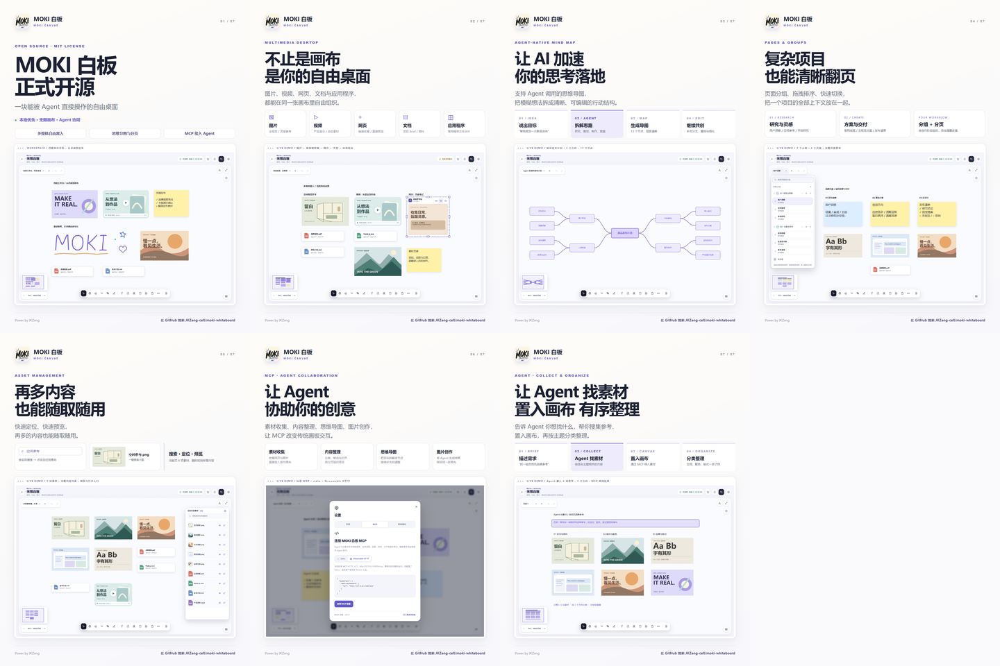
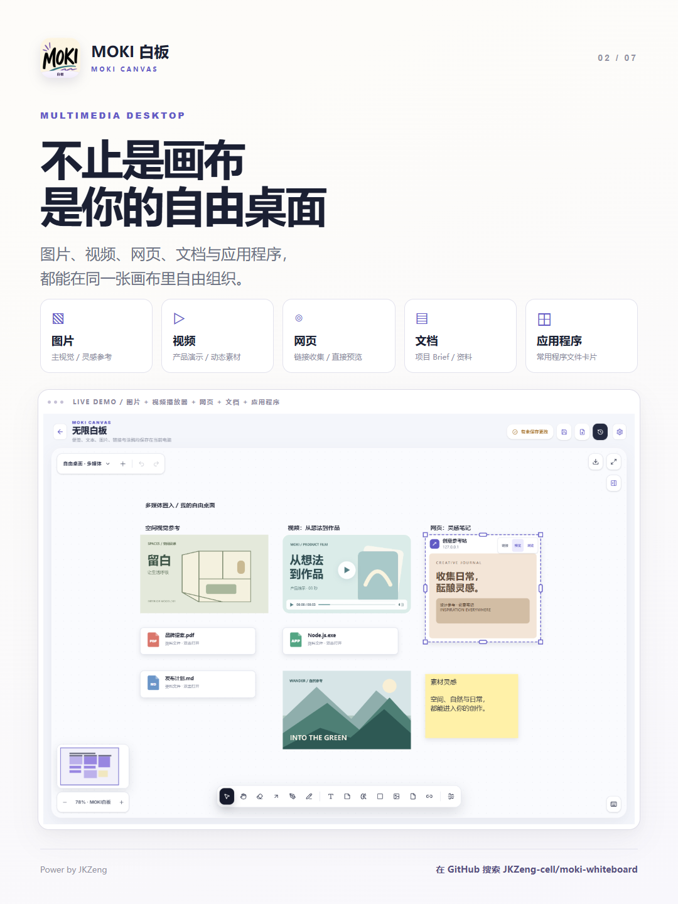
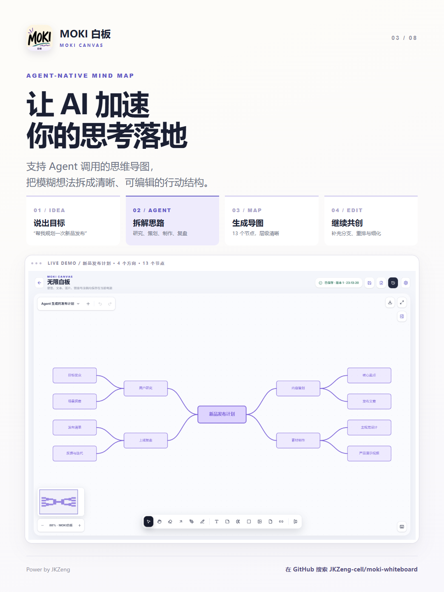
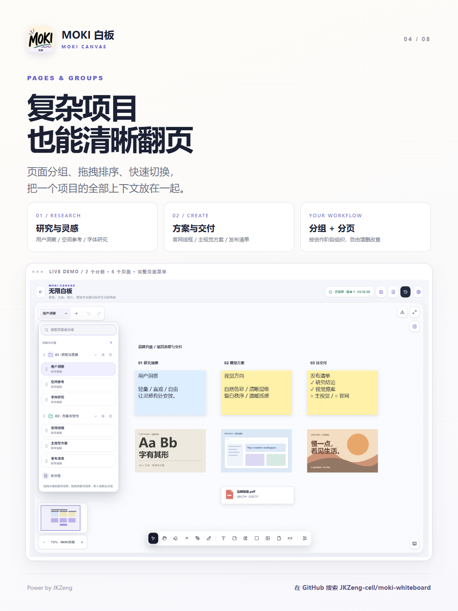
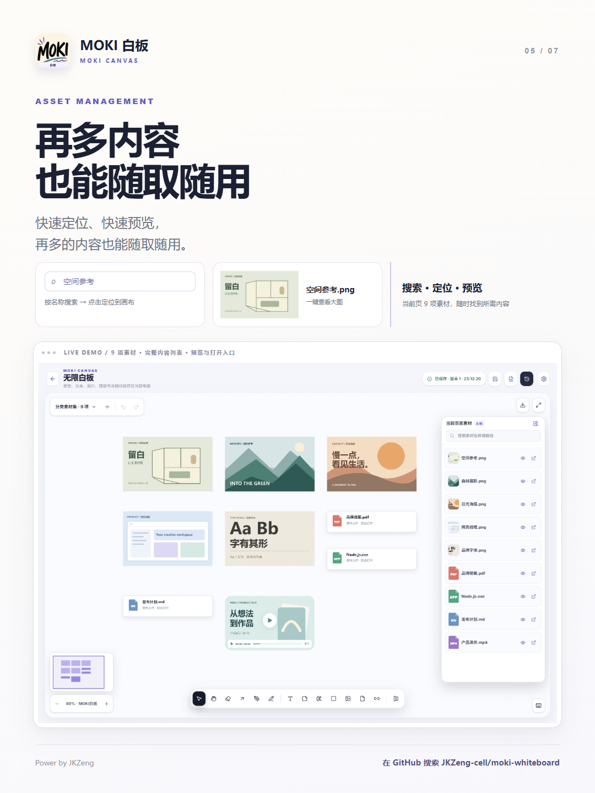
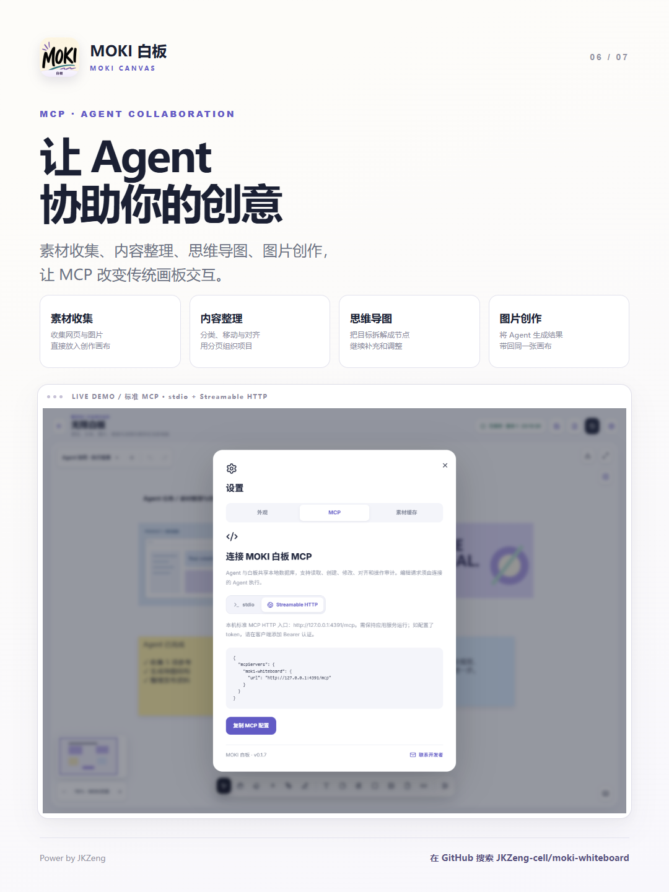

# MOKI 白板介绍 · MOKI Whiteboard Showcase

[项目首页 / Project home](../../README.md) · [发布文案 / Chinese social copy](publish-copy.zh-CN.md) · [HTML 排版源文件 / HTML composition](release-cards.html)

七张 3:4 静态发布图，每张 1080 × 1440。点击图片可查看原图；以下页面可直接在 GitHub 浏览。

Seven static 3:4 launch images, each 1080 × 1440. Click an image to open the original. This page is viewable directly on GitHub.

## 01 · 开源自由桌面 / An Open-Source Creative Desktop

本地优先的无限画布，让人和 Agent 共同创作。封面展示原生画笔手写 MOKI 与涂鸦图形。

A local-first infinite canvas for people and agents. The cover includes MOKI lettering and shapes drawn with the native brush.

## 02 · 不止是画布 是你的自由桌面 / More Than a Canvas

图片、视频、网页、文档和应用程序文件放到同一张画布中，集中整理参考与素材。

Bring images, videos, web pages, documents, and application files onto one canvas to organize references and assets together.

## 03 · 让 AI 加速你的思考落地 / Turn Ideas into Action with AI

支持 Agent 调用的思维导图：拆解目标、组织节点，继续由你编辑与完善。

Agent-editable mind maps help break down goals and organize ideas, while keeping the result editable by you.

## 04 · 复杂项目 也能清晰翻页 / Keep Complex Projects Organized

通过多页面、分组和快速切换，让研究、方案与发布清单保留各自的上下文。

Use multiple pages, groups, and quick navigation to keep research, proposals, and launch checklists in context.

## 05 · 再多内容 也能随取随用 / Keep Assets Within Reach

素材列表支持搜索、定位、预览与打开；不同图片和文件类型使用不同演示内容。

Search, locate, preview, and open assets from the list. The demo uses distinct images and file types.

## 06 · 让 Agent 协助你的创意 / Let Agents Join Your Creative Workflow

通过标准 MCP stdio 或 Streamable HTTP 接入 Agent，协助素材收集、内容整理、思维导图与图片创作工作流。

Connect an agent through standard MCP stdio or Streamable HTTP for asset collection, content organization, mind maps, and image-creation workflows.

## 07 · 让 Agent 找素材 置入画布 有序整理 / Collect and Organize with an Agent

演示通过 MCP 将六项参考素材置入画布，并按“空间与结构、自然与配色、品牌与版式”三个方向整理。

The demo places six reference assets on the canvas through MCP and organizes them into space and structure, nature and color, and branding and layout.

## 编组收起为虚拟文件夹 分组管理整洁有序 / Keep Groups Tidy with Virtual Folders

把相关图片、文件、便签和其他画布内容编为一组，再通过“收起为资料夹”折叠成一个虚拟文件夹。暂时不用的内容收起来，需要时再展开，让画布清爽、分组清晰，创作井然有序。

Group related images, files, notes, and other canvas content, then collapse the group into a virtual folder using “收起为资料夹” (Collapse to folder). Tuck away content you are not using and expand it when needed to keep the canvas tidy and organized.

操作顺序：多选内容 → 编组 → 右键“收起为资料夹”；需要时选择“展开资料夹”。这是当前页面内的内容整理，与上面的页面分组不同；虚拟文件夹是画布对象，不是磁盘文件夹。

Workflow: select multiple items → group them → choose “收起为资料夹” from the context menu. Choose “展开资料夹” (Expand folder) to show the contents again. This organizes content within a page, separately from page groups; a virtual folder is a canvas object, not a folder on disk.

## 演示说明 / Demo Notes

- 截图来自隔离的内存演示数据库，不包含用户真实白板。视频播放组件与分类图标包含发布截图表现增强。
- 找素材示例使用本地演示参考库；网页搜索、图片生成等能力由连接的 Agent 及其工具提供，并非白板内置的搜索引擎或生成模型。
- 原始排版源文件为 `release-cards.html`，可在本地浏览器打开；添加 `?card=1` 到 `?card=7` 可查看单张。GitHub 文件浏览器不会直接运行 HTML。
- 本目录仅包含公开展示材料，不含数据库、素材缓存、认证配置或安装包。

- Screenshots use an isolated in-memory demo database, not real user boards. Video controls and file-type icons include presentation-only enhancements.
- The collection example uses a local demo reference library. Web search and image generation depend on the connected agent and its tools; they are not built-in search engines or generative models.
- Open `release-cards.html` in a local browser to view the original composition. Add `?card=1` through `?card=7` for an individual image. GitHub's file browser does not execute HTML.
- This directory contains public showcase materials only: no databases, asset caches, credentials, or installers.

在 GitHub 搜索 / Search GitHub: `JKZeng-cell/moki-whiteboard`
